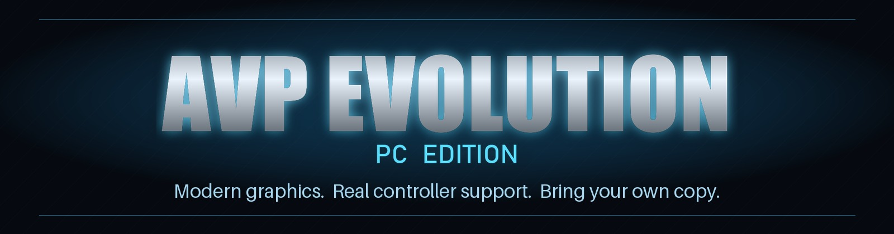

<div align="center">



### AVP Evolution on PC, rebuilt with modern graphics, real controller support and a launcher made for the couch.


&nbsp;
[](https://discord.gg/8eakYSvBZS)


<br>

<sub>The 2013 Android game rebuilt in Unity for Windows, with a new PC layer on top. <b>No game files included</b>: this repository holds the port's own code only, and you need your own purchased copy of the game.</sub>

</div>

<br>

> [!NOTE]
> **There are no release builds yet.** This repository is the source code of the port. See [Getting started](#getting-started) for where things stand.

## At a glance

| | | |
| :--- | :--- | :--- |
| 👾 **The whole game**: both campaigns, the side missions and the bonus level | 🖥️ **Native resolution** up to 4K and ultrawide, with an adjustable field of view | ✨ **NVIDIA DLSS, AMD FSR 1 and Intel XeSS** upscaling |
| 🎮 **Xbox-style controllers** read directly, with **rumble** | 🔘 **Button glyphs** in tips, on the HUD and on the controls screen, Xbox or PlayStation | ⌨️ **Keyboard and mouse** with mouse look and proper PC wording |
| 🌅 **HDR bloom, SSAO, ACES tone mapping** and a colour grade for each campaign | 🔦 **Volumetric light shafts** and **realtime character shadows** | 🧽 **SMAA, FXAA or TAA**, and **16x texture filtering** |
| 🖼️ **1024 character and weapon textures**, the set phones never used | 💡 **Enhanced lighting**: characters pick up the colour of the lamps around them | 🚀 **Uncapped frame rate**, a frame limiter and V-Sync |
| 🛋️ **A console style launcher** with presets and every setting in one place | 📦 **Installs from your own** `.apk` and `.obb` | ↩️ **Back to the launcher** any time: hold Esc, or hold View + Menu |

## The game

<div align="center">

<sub><b>Become the hunter, or the hive.</b> Fight through two campaigns as a Predator warrior and as an Alien, with combos, stealth, executions and upgrades.</sub>

</div>

- **19 campaign levels**: 9 as the Predator and 10 as the Alien
- **13 side missions** and the **bonus level**
- All of them start and render on PC. They have been checked at each level's opening area, but the game has not yet been played through from start to finish

## Getting started

**You need:** Windows 10 or 11 (64 bit) with a DirectX 11 graphics card, and your own copy of the Android game: the `.apk` and its `.obb`, from your purchase on Google Play.

**Where things stand:** the port runs and the launcher works, but the game's assets currently go into each build, so a build can't be shared. A release has to build the game on your PC from your own files instead, and that converter is the next big job. Until then, there is nothing to download here.

For now you can read the code, or follow [BUILDING.md](BUILDING.md) if you have your own copy and some patience. **Please don't ask for builds or game files.**

### Which files you need

The port was made and tested with the final Google Play version:

| File | Version | Size | SHA1 |
| --- | --- | --- | --- |
| `com.fde.avpevolution_2.1.apk` | 2.1 (808) | 29,150,810 bytes | `BF9F6CE40C350D4E383B544C51803FB650BC2F01` |
| `main.808.com.fde.avpevolution.obb` | 808 | 494,458,650 bytes | |

To check the `.apk` yourself, run this in PowerShell and compare the result with the SHA1 above:

```powershell
Get-FileHash "C:\Games\com.fde.avpevolution_2.1.apk" -Algorithm SHA1
```

> [!WARNING]
> The older OUYA version of the game (1.5.1) is a trial and is not what this port is built on.

## The launcher

The port uses the [TRG Launcher](https://github.com/TekRantGaming/trg-launcher) 2.0. Everything is set up before the game starts, with a controller, the keyboard or the mouse.

### Install from your own files
- Point the launcher at your `.apk` and `.obb`
- A card shows **exactly which files work**: version, size and hashes
- It checks the package really is AVP Evolution before it does anything

### Display and Graphics
- **Fullscreen** or **windowed**, resolution and **V-Sync**
- **Frame rate**: a limit of your choice, or **no limit**
- **Upscaler**: DLSS, FSR 1 or XeSS, with their quality modes
- **Presets**, or set each option yourself
- **Anti aliasing**, **texture filtering**, **shadows**, **ambient occlusion**, **draw distance**, **bloom**, **tone mapping**, **colour grading**, **light shafts** and **enhanced lighting**
- **Field of view**, and a **HUD** you can scale and keep near the middle on ultrawide screens

### Controls
- **Mouse** and **stick sensitivity**, and **invert vertical look**
- **Capture the mouse** while you play
- **Controller rumble** on or off
- **Button glyphs**: automatic, Xbox, PlayStation or keyboard
- The full list of **keys and buttons**

## Android vs PC

| | Android | PC |
| --- | :---: | :---: |
| Resolution | the phone's screen | native, up to 4K and ultrawide |
| Frame rate | depends on the device | V-Sync, a limit of your choice, or no limit |
| Upscaling | none | DLSS, FSR 1 or XeSS |
| Anti aliasing | mobile | SMAA, FXAA or TAA |
| Textures | 512 on most devices | 1024 characters and weapons, 16x filtering |
| Lighting | baked | baked, with lamps lighting the characters per pixel |
| Effects | mobile | HDR bloom, SSAO, ACES, colour grading, light shafts |
| Shadows | mobile | realtime character shadows, up to 4 cascades |
| Controls | touch screen | controller with rumble, keyboard and mouse |
| Prompts | touch buttons | Xbox, PlayStation or keyboard glyphs and wording |

## Good to know

### Controls

| Action | Keyboard and mouse | Controller |
| --- | --- | --- |
| Move / camera | <kbd>W</kbd> <kbd>A</kbd> <kbd>S</kbd> <kbd>D</kbd>, mouse | left stick, right stick |
| Attack / use (hold for heavy) | left mouse | <kbd>X</kbd> |
| Jump / evade | right mouse or <kbd>Space</kbd> | <kbd>A</kbd> |
| Execution | <kbd>X</kbd> | <kbd>B</kbd> |
| Ranged / lock on | <kbd>F</kbd> | <kbd>Y</kbd> |
| Special abilities | <kbd>R</kbd>, <kbd>G</kbd> | <kbd>LB</kbd>, <kbd>RB</kbd>, <kbd>LT</kbd> |
| Weapons (Predator) | <kbd>Q</kbd>, <kbd>E</kbd> | D-pad up, down |
| Thermal / cloak | <kbd>T</kbd>, <kbd>C</kbd> | D-pad left, right |
| Switch attacks / rage (Alien) | <kbd>Q</kbd>, <kbd>E</kbd> | D-pad |
| Show the way / centre camera | <kbd>Tab</kbd>, <kbd>V</kbd> | stick clicks |
| Pause | <kbd>Esc</kbd> | <kbd>Menu</kbd> or <kbd>View</kbd> |

### Hotkeys

| Key | Action |
| --- | --- |
| Hold <kbd>View</kbd> + <kbd>Menu</kbd>, or hold <kbd>Esc</kbd> | back to the launcher while playing |
| <kbd>F1</kbd> | the controls, in a level |

### Known limits

- **Xbox-style (XInput) controllers** are read directly. The DualShock 4 goes through the game's own input library, and pads that library doesn't know, such as the DualSense, are untested
- **XeSS** needs an Intel Arc graphics card, and falls back to FSR 1 on other cards. So does DLSS on cards that don't support it
- Some recent changes (the controller layout, rumble and the softer character lights) still need testing in a full play session
- Some players have reported texture popping, and the cause hasn't been found yet

### Reporting a problem

Please open an [issue](https://github.com/TekRantGaming/avp-evolution-pc-edition/issues) with the level, what happened, your CPU, graphics card and your settings, or ask on the [Discord](https://discord.gg/8eakYSvBZS).

## About the game

*AVP Evolution* was made by Angry Mob Games and published by Fox Digital Entertainment in 2013, for phones and tablets. It has since been delisted.

The game was built in Unity, so instead of translating the Android program, this port rebuilds it as a Windows project and adds a PC layer on top: the settings, the graphics, the controls and the launcher. That layer is what you will find here.

<details>
<summary><b>Building from source (for developers)</b></summary>

See [BUILDING.md](BUILDING.md). The game's scripts, shaders and assets are not in this repository, so building needs your own copy of the game, and the small changes made to the game's own scripts are described in [docs/GAME_SCRIPT_CHANGES.md](docs/GAME_SCRIPT_CHANGES.md). The story of the port, and the rendering problems that had to be solved along the way, is in [docs/PORTING_NOTES.md](docs/PORTING_NOTES.md).

</details>

## Credits

- **AVP Evolution** by Angry Mob Games, published by Fox Digital Entertainment in 2013.
- [**AssetRipper**](https://github.com/AssetRipper/AssetRipper), used to recover the Unity project from your own copy of the game.
- The [**TRG Launcher**](https://github.com/TekRantGaming/trg-launcher), shared by the TekRantGaming ports, with [**Dear ImGui**](https://github.com/ocornut/imgui), [**SDL**](https://www.libsdl.org) and [**stb**](https://github.com/nothings/stb).
- Upscaling: [**AMD FidelityFX Super Resolution 1**](https://github.com/GPUOpen-Effects/FidelityFX-FSR) (MIT licensed), [**NVIDIA DLSS**](https://github.com/NVIDIA/DLSS) and [**Intel XeSS**](https://github.com/intel/xess). The DLSS and XeSS SDKs are not included here.
- [**Unity Post-processing Stack v1**](https://github.com/Unity-Technologies/PostProcessing) for bloom, SSAO, tone mapping and colour grading.
- [**SMAA**](https://www.iryoku.com/smaa/) by Jorge Jimenez and others, with the [**Unity port**](https://github.com/Chman/SMAA) by Thomas Hourdel (MIT licensed).
- [**ViGEmBus**](https://github.com/nefarius/ViGEmBus) and [**vgamepad**](https://github.com/yannbouteiller/vgamepad) for testing controllers.
- The controller glyphs were drawn for this project with `tools/make_glyphs.py`. Xbox and PlayStation are trademarks of their owners.

> [!NOTE]
> **AI disclosure:** this port was made almost entirely with Claude Code (Anthropic). The repository owner directed and tested the work; the AI did the analysis, code, tools and documentation.

> [!IMPORTANT]
> This project is not affiliated with or endorsed by 20th Century Studios, The Walt Disney Company, Fox Digital Entertainment, Angry Mob Games, Microsoft, Sony, NVIDIA, AMD, Intel, Unity or Discord. All trademarks belong to their owners. It contains no game code or assets. Do not open issues asking for game files or builds.
